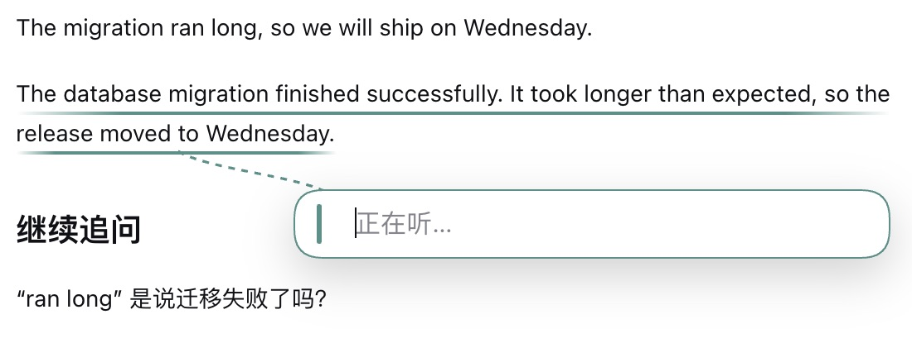
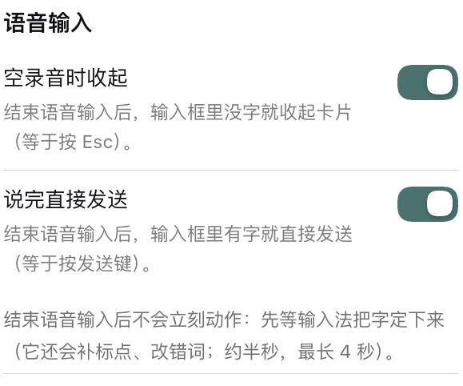
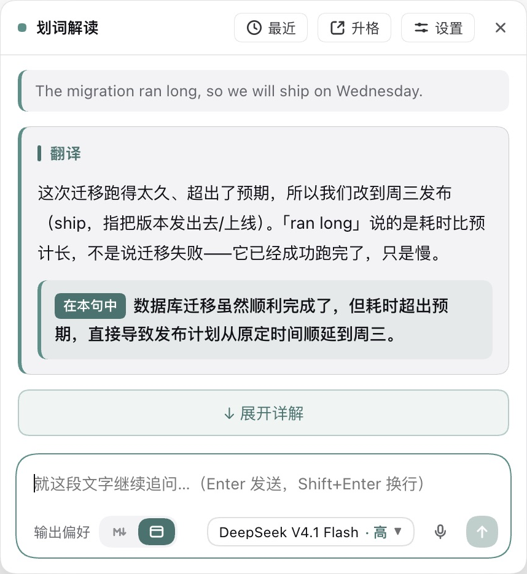
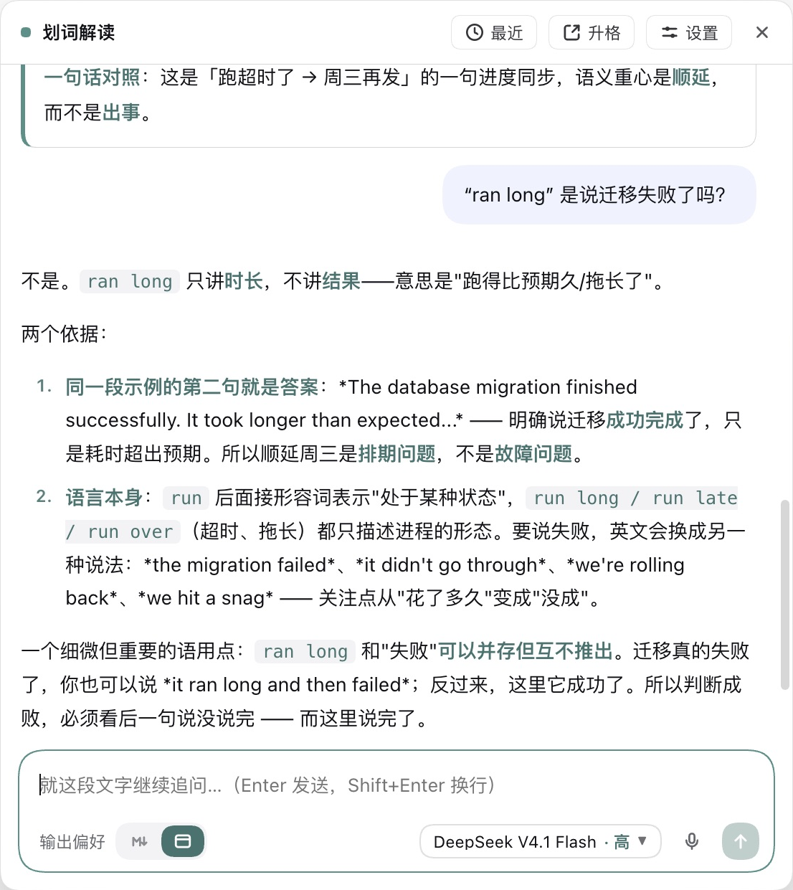
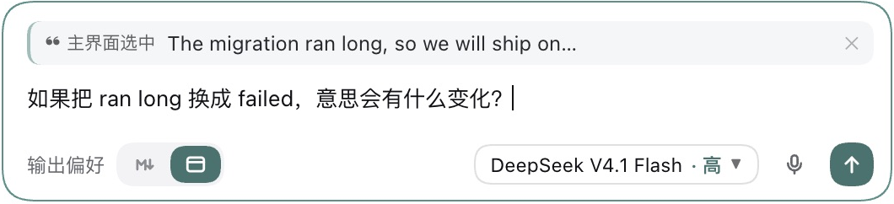

<div align="center">

# 划词解读

**划一下，说一句。把不懂的地方，就地问明白。**

DSH 中的翻译、上下文解读与语音追问。

[快速安装](#install) · [语音输入](#voice) · [功能一览](#read) · [使用与设置](#settings)

`DSH 插件` · `v0.10.3` · `MIT`

</div>

---

<a id="voice"></a>

## 01 / 划完，直接说

选中一句话，直接用语音问“它在这里是什么意思？”——问题留在选区旁，回答接着出现在小窗里。

### 从划词到提问，一口气完成

**小窗还没打开**：划选文字后启动输入法语音，选区旁会出现临时卡片，承接你说的话。结束语音、文字定稿后，默认自动发送，直接进入追问。



*选区通过青色下划线和虚线连接到临时输入卡片。*

**小窗已经打开**：划选新的文字，再启动输入法语音。这段文字会作为引用加入小窗，你说的话写入追问框。

### 在小窗里，也能直接开口

点击输入框旁的麦克风开始录音，查看实时波形与转写；点击停止完成输入，或按 `Esc` 取消本次录音。实时转写不可用时，会在停止后识别。


*英文例句的解读小窗中，直接启动语音追问。*

语音卡片默认开启**说完直接发送**和**空录音时收起**。在 **设置 → 界面 → 语音输入** 中可以分别关闭。



> 输入法联动需要 **macOS 14.4+** 与支持的语音输入法（已适配豆包）。小窗麦克风需要 DSH 启用语音识别服务。未配置语音时，文字解读与键盘追问仍可使用。

<details>
<summary>小窗麦克风提示不可用？</summary>

请检查 DSH 宿主是否启用了 `@deepseek-ai/dsh-experimental-speech-to-text`，以及识别模型是否已就绪。首次使用时，如果小窗显示 **准备模型**，点击后按提示准备；下载与识别在宿主运行。

这与输入法语音是两个独立入口：输入法联动使用输入法本身的识别能力。

</details>

<a id="read"></a>

## 02 / 先读懂，再深入

在 DSH 中选中文字，点击 **解读**。英文先给译文，中文按内容给解读，代码则生成注释；需要更多背景时，再点 **展开详解**。



*选中 “The migration ran long, so we will ship on Wednesday”，先得到译文。*

展开后，模型结合前后文与可用的会话背景解释术语、语气和承接关系。你可以直接在底部继续追问。



*接着问“ran long 是说迁移失败了吗？”，把问题留在同一段讨论里。*

<a id="quotes"></a>

## 03 / 把相关内容，一起带进来

小窗打开时，在主界面、小窗正文或支持的侧边栏网页预览中划选文字，点 **引用**，就能带着新材料继续问。一次最多加入 **4 段引用**，每段都可以单独移除。



不必每次从头来：

| 想做什么 | 入口 |
| --- | --- |
| 回到刚才的解读 | 右下角悬浮胶囊，或小窗里的 **最近** |
| 把讨论继续做下去 | **升格**，将解读与追问带入正式会话 |
| 阅读代码 | 选中代码，查看注释与原代码交替呈现的解释 |
| 用图表理解复杂问题 | 将**输出偏好**切为网页，模型可生成 HTML 页面 |

<a id="install"></a>

## 快速安装

这是 DSH 环境中的插件。请先安装 DSH、配置一个可用模型，再运行：

```bash
dsh plugin --profile web add @yfwu2020/dsh-selection-explain
```

安装后刷新 DSH 页面，选中一段文字，点击 **解读** 即可。

也可在 [GitHub Releases](https://github.com/yfwu2020/dsh-selection-explain/releases) 下载构建包，按下方说明安装。

<details>
<summary>安装 Release 构建包</summary>

将下载的 `.tgz` 放到当前目录，以 v0.10.3 为例：

```bash
mkdir -p ~/.dsh/plugins/dsh-selection-explain
tar -xzf yfwu2020-dsh-selection-explain-0.10.3.tgz -C ~/.dsh/plugins/dsh-selection-explain --strip-components=1
dsh plugin --profile web add ~/.dsh/plugins/dsh-selection-explain
```

安装完成后刷新 DSH 页面。其他版本请替换文件名中的版本号。

</details>

<details>
<summary>从源码安装 / 卸载</summary>

```bash
git clone https://github.com/yfwu2020/dsh-selection-explain.git
cd dsh-selection-explain
npm install
npm run build
dsh plugin --profile web add .
```

源码构建需要 package.json 中列出的 DSH 开发依赖可用。

卸载 npm 安装的插件：

```bash
dsh plugin --profile web remove @yfwu2020/dsh-selection-explain
```

</details>

<a id="settings"></a>

## 使用与设置

`Enter` 发送 · `Shift+Enter` 换行 · `Esc` 收起小窗。录音期间，第一次 `Esc` 只取消录音，再按一次才关闭小窗。

点击小窗顶部的 **设置**，修改会自动保存：

| 设置 | 可以调整什么 |
| --- | --- |
| 模型 | 跟随主会话，或为解读单独指定模型 |
| 思考强度 | 首轮、次轮与追问分别选择 **关 / 低 / 高 / 最高**；按模型实际能力映射 |
| 背景 | 是否附带会话消息，以及引用的上下文范围 |
| 联网 | 是否允许模型调用工具，以及允许的工具范围 |
| 界面 | 语音卡片收尾、侧边栏网页划词与悬浮胶囊 |
| 数据 | 保留多少条最近解读 |

### 与完整视图、最近会话共存（0.10.2）

解读小窗使用自己的浮层，显示在最近会话列表和完整视图工作面板上方，空白区域仍可点击原界面。在完整视图里，解读插件自行隐藏悬浮胶囊；返回分栏后恢复。

聊天与解读可以同时打开。与 `dsh-full-view` **0.1.6**、`dsh-recent-sessions` **0.2.3** 配合时，`Esc` 先退出最后操作的小窗；点击两窗之外后先退解读，再按一次收起聊天。此次调整需一起更新两个插件，未改变 Harness 的公共浮层或设置。

### 快捷键与 Esc 层级（0.10.3）

模型菜单收起后不再被 DSH 识别为弹层，避免设置等快捷键失效。官方设置等模态浮层打开时，`Esc` 优先交给官方浮层处理，保留解读小窗、插件设置抽屉、模型菜单和语音卡；官方浮层关闭后，再按 `Esc` 继续退出插件层级。

## 数据与使用范围

选中文字、必要的前后文，以及开启的会话背景会交给你配置的模型。可在设置中关闭会话背景或工具调用。

插件不将录音保存为音频文件，也不把音频附到会话；小窗录音由 DSH 配置的识别服务处理，是否经过云端取决于该服务。输入法语音由输入法本身处理，插件接收输入框中写入的文字。

解读历史默认保留最近 **20 条**，以明文存储在 `~/.dsh/selection-explain/history.json`。可在 **设置 → 数据** 中调整，设为 `0` 停止保存新历史；已有历史不会因此清空。

支持 DSH 界面与可注入的侧边栏 HTML 预览。输入框、源码视图、外部站点浏览器标签页，以及部分第三方预览不触发划词（直接通过独立 URL 加载、无法注入划词桥的页面）。模型回答与联网查证仍可能出错。

<details>
<summary>开发与兼容性</summary>

依赖 DSH 的 `webServer`、`llm` 等宿主服务；具体版本范围见 [package.json](https://github.com/yfwu2020/dsh-selection-explain/blob/main/package.json)。

```bash
npm test
npm run typecheck
npm run build
```

配置项见 [src/settings.ts](https://github.com/yfwu2020/dsh-selection-explain/blob/main/src/settings.ts)，默认值见 [src/index.ts](https://github.com/yfwu2020/dsh-selection-explain/blob/main/src/index.ts)。

</details>

---

[MIT License](https://github.com/yfwu2020/dsh-selection-explain/blob/main/LICENSE) · [反馈问题](https://github.com/yfwu2020/dsh-selection-explain/issues)
